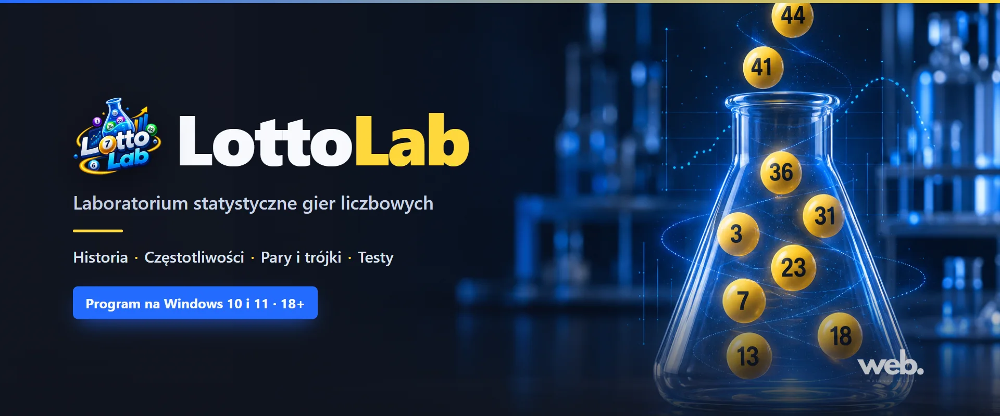
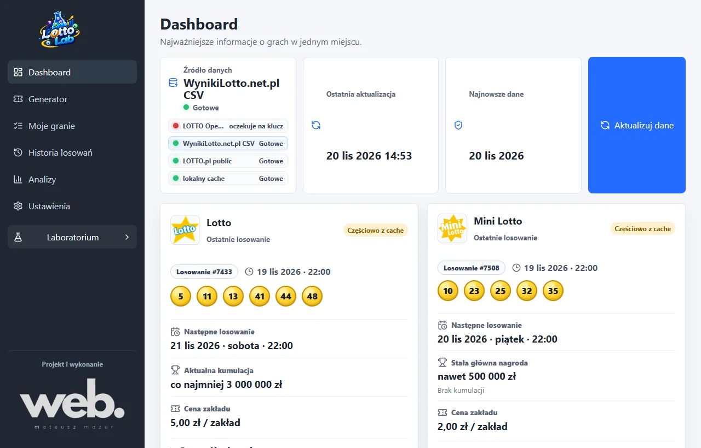
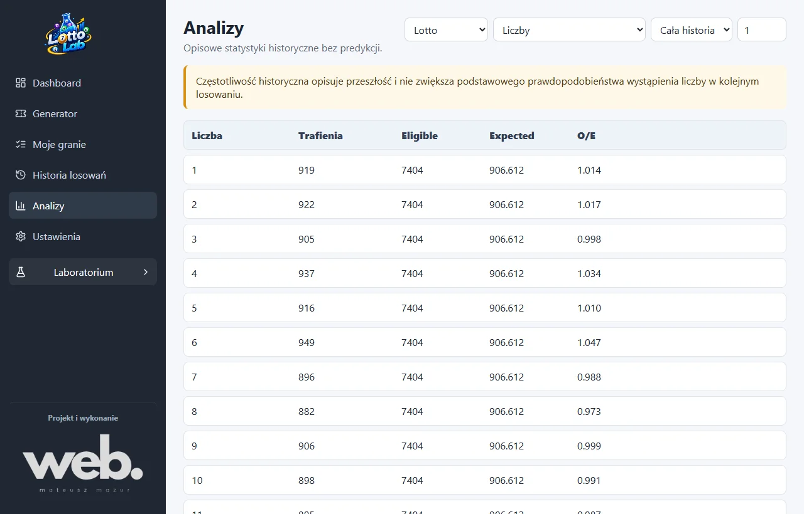
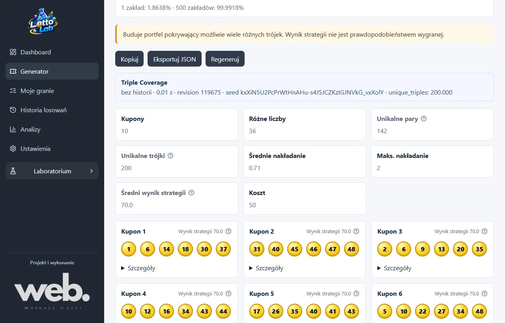
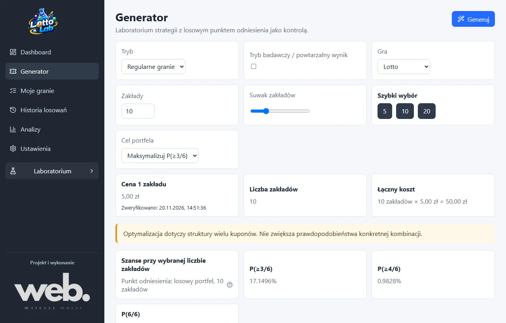
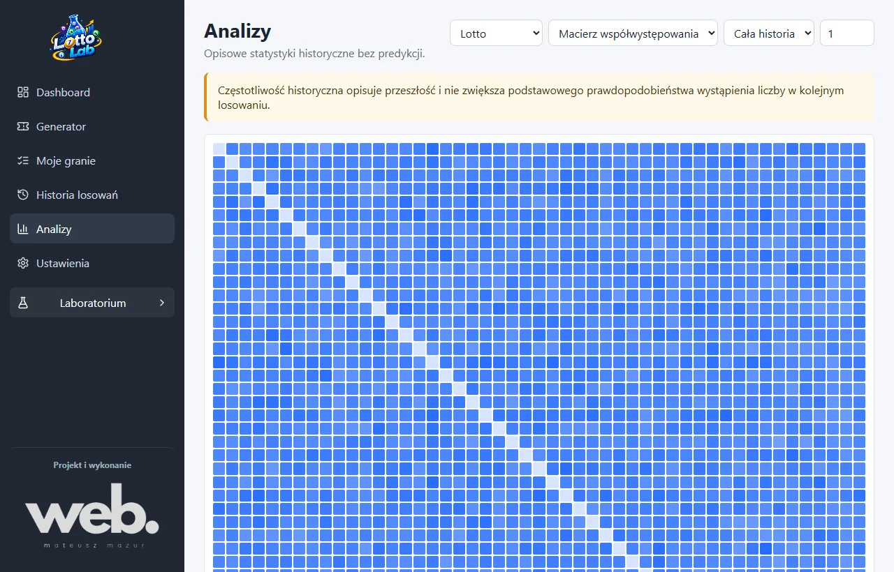
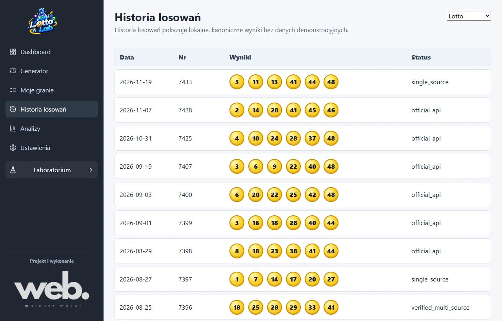

<h1 align="center">LottoLab</h1>

<b>Statystyki Lotto, Multi Multi, Mini Lotto i EuroJackpot na Twoim komputerze.</b> 
Darmowy program na Windows 10 i 11 · 18+

  <a href="https://github.com/Webmazur/lotto-lab/releases/latest"><b>⬇ Pobierz najnowszą wersję</b></a> ·
  <a href="https://www.webmazur.pl/programy/lotto-lab/">Opis programu na webmazur.pl</a>

LottoLab to program do analizy historycznych wyników polskich gier liczbowych. Trzyma pełną historię losowań w bazie na Twoim komputerze, liczy statystyki, porównuje strategie z losowym typowaniem i pokazuje dokładne szanse oraz koszty.

> **Ważne.** Losowania są losowe. Żadna analiza historii nie przewiduje przyszłych wyników: każda kombinacja zgodna z zasadami gry ma takie samo prawdopodobieństwo wylosowania. LottoLab nie obiecuje wygranych. Gry liczbowe są dla osób pełnoletnich. Graj odpowiedzialnie.

## Pobieranie

Instalator `LottoLab-Setup-<wersja>.exe` znajdziesz w zakładce [Releases](https://github.com/Webmazur/lotto-lab/releases/latest). Bez rejestracji i bez maila.

To repozytorium zawiera tylko opis, licencję i instalatory. Kod programu nie jest publiczny.

## Funkcje

- **Dashboard** – ostatnie losowania wszystkich gier, termin następnego losowania, kumulacja i cena zakładu.
- **Statystyki** – częstotliwości liczb na tle wartości oczekiwanej, przerwy, pary, trójki, kształt losowania, macierz współwystępowania, test chi-kwadrat. Dla całej historii albo ostatnich 20–500 losowań.
- **Generator** – 8 strategii doboru liczb (m.in. zrównoważony kształt, ważenie częstotliwością, pokrycie par i trójek), z możliwością wymuszenia lub wykluczenia liczb. Każdy wynik porównany z losowym typowaniem.
- **Regularne granie** – zestaw kuponów pod wybrany cel (np. jak najwięcej szans na trójkę), które się nie dublują. Szanse liczone dokładnie i porównane z losowym zestawem.
- **Moje granie** – zapis zagranych kuponów, automatyczne rozliczenie po losowaniu i porównanie z kuponami kontrolnymi.
- **Historia losowań** – pełne archiwum wyników, automatyczne uzupełnianie braków, kopie zapasowe i kontrola bazy.
- **Backtesting** – jak strategia wypadłaby na historii w porównaniu z losowym typowaniem.

| Dashboard | Statystyki liczb |
| --- | --- |
|  |  |

| Generator | Regularne granie |
| --- | --- |
|  |  |

| Pary liczb | Historia losowań |
| --- | --- |
|  |  |

## Obsługiwane gry i szanse

| Gra | Losowanie | Szansa na główną wygraną |
| --- | --- | --- |
| Lotto | 6 z 49 | 1 : 13 983 816 |
| Mini Lotto | 5 z 42 | 1 : 850 668 |
| EuroJackpot | 5 z 50 + 2 z 12 | 1 : 139 838 160 |
| Ekstra Pensja (z Ekstra Premią) | 5 z 35 + 1 z 4 | 1 : 1 298 528 |
| Multi Multi | 20 z 80, od 1 do 10 liczb | 1 : 8 911 711 (10 z 10) |
| Kaskada | 12 z 24, dwa losowania dziennie | 1 : 2 704 156 (12 z 12) |

Kaskada jest loterią: zestawy na losie są wybierane losowo przy zakupie, więc generator służy w niej do analizy.

## Wymagania

- Windows 10 albo 11, 64-bit
- Internet do pobierania wyników (statystyki działają bez sieci)
- Opcjonalnie: własny, bezpłatny klucz [LOTTO OpenAPI](https://developers.lotto.pl/)

## Instalacja

1. Pobierz i uruchom `LottoLab-Setup-<wersja>.exe`.
2. Jeśli Windows SmartScreen ostrzeże o nieznanym wydawcy, wybierz **Więcej informacji → Uruchom mimo to**. Instalator nie jest jeszcze podpisany cyfrowo.
3. Instalator tworzy skrót na pulpicie i w menu Start.

Przy pierwszym uruchomieniu program zakłada lokalną bazę i w tle pobiera historię wyników. W tym czasie można normalnie z niego korzystać.

**Klucz LOTTO OpenAPI.** Z kluczem wyniki przychodzą zaraz po losowaniu. Wygenerujesz go za darmo na [developers.lotto.pl](https://developers.lotto.pl/) i wkleisz w okienku przy pierwszym starcie albo w **Ustawienia → Źródło danych**. Klucz jest zapisywany na Twoim komputerze w postaci zaszyfrowanej (Windows DPAPI) i wysyłany wyłącznie do API LOTTO. Bez klucza program korzysta z publicznego archiwum wyników, które może być aktualizowane z opóźnieniem.

**Aktualizacja** – uruchom nowy instalator. Baza wyników i zapisane kupony zostają.

**Dane** – baza, kopie zapasowe i logi są w `%APPDATA%\LottoLab`. Przy odinstalowaniu zostają, chyba że zaznaczysz „Usuń również dane Lotto Lab”.

## Zastrzeżenia

LottoLab jest niezależnym programem i nie jest powiązany z Totalizatorem Sportowym ani przez niego wspierany. Nazwy gier są używane wyłącznie w celu ich identyfikacji. Wyniki pochodzą z LOTTO OpenAPI i publicznych archiwów; w razie rozbieżności rozstrzygają oficjalne wyniki Totalizatora Sportowego. Program nie przyjmuje zakładów i nie pośredniczy w grach.

Jeśli granie przestaje być zabawą, skorzystaj z bezpłatnej pomocy: telefon zaufania dla osób uzależnionych behawioralnie **801 889 880**.

## Licencja

Program jest darmowy do użytku prywatnego. Możesz bezpłatnie udostępniać niezmieniony instalator. Nie wolno go sprzedawać ani rozpowszechniać zmienionych wersji. Pełne warunki: [LICENSE.txt](LICENSE.txt).

## Autor

Projekt i wykonanie: **Mateusz Mazur – [Webmazur](https://www.webmazur.pl/)**. Uwagi i zgłoszenia błędów: [formularz kontaktowy](https://www.webmazur.pl/kontakt/).
